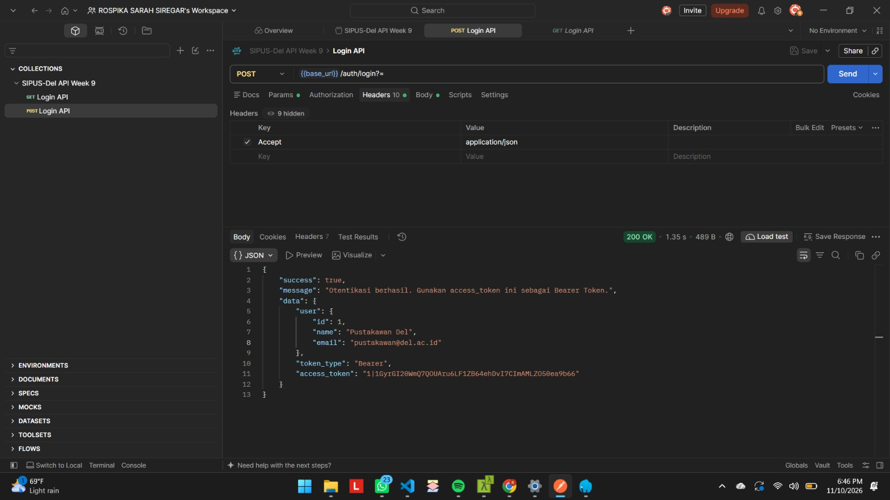
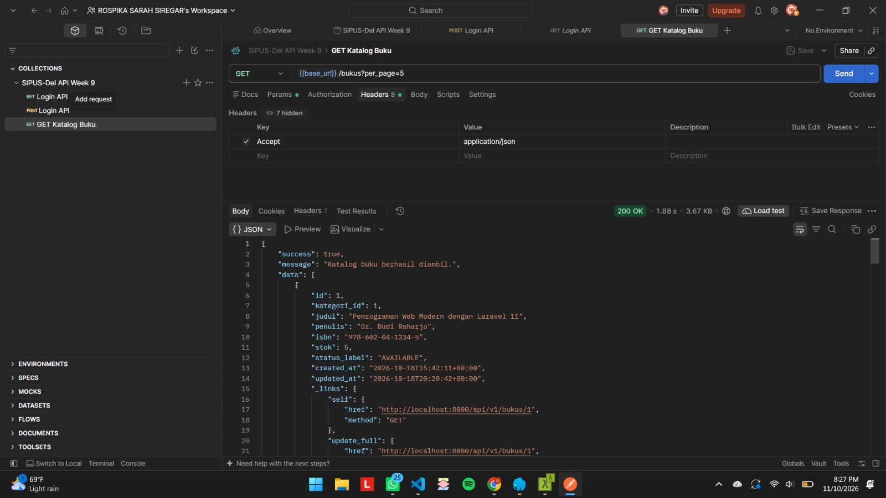
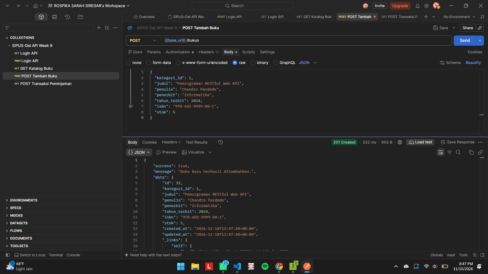
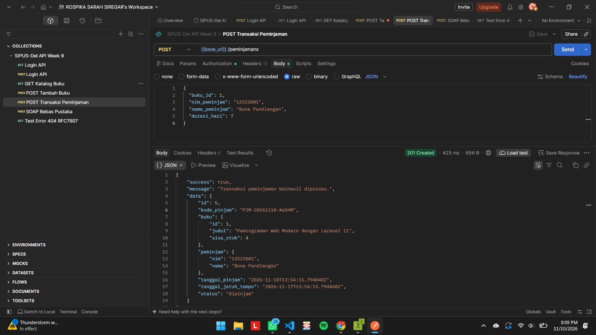
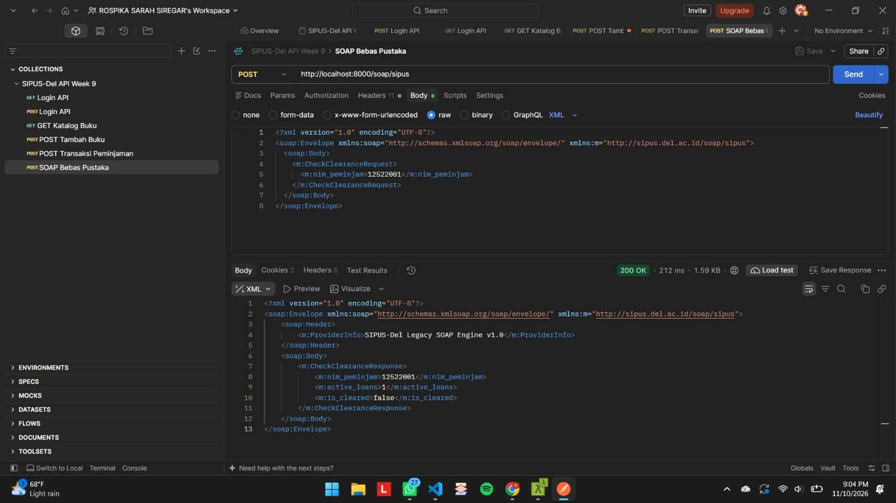
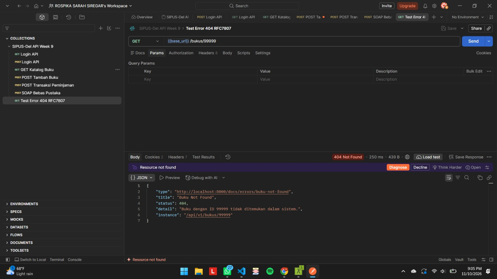
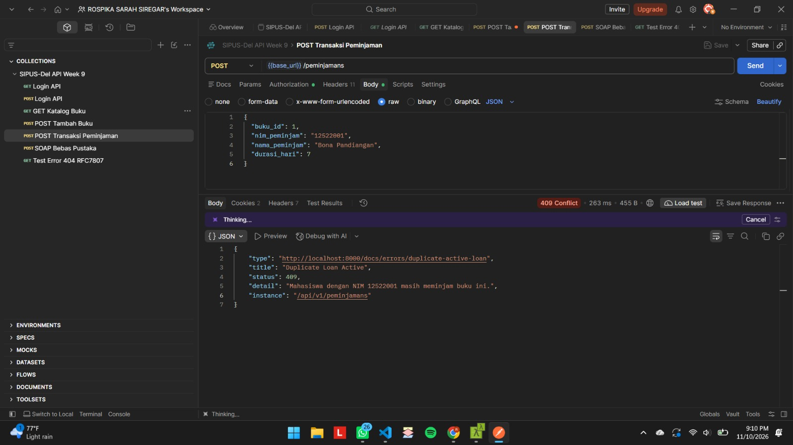

# Laporan Praktikum Minggu 9 - SIPUS-Del (Backend Tahap 3: REST API & SOAP Web Services)

## 1. Identitas Mahasiswa
- **Nama:** Rospika Sarah Yosefin Siregar
- **NIM:** 12S24008
- **Program Studi:** S1 Sistem Informasi
- **Mata Kuliah:** Pemrograman dan Pengujian Aplikasi Web (1253101)
- **Repositori:** `ppw-2026-week9-12S24008`
- **Branch:** `week9-rest-api`

---

## 2. Analisis Kebutuhan & Kelayakan Web Services

### Peran Sistem pada SIPUS-Del:
1. **Service Provider (REST API):** Menyediakan katalog buku terpaginasi (`/api/v1/bukus`) dan transaksi peminjaman sirkulasi (`/api/v1/peminjamans`) untuk konsumsi aplikasi web/mobile.
2. **Service Consumer (REST API):** Mengonsumsi OpenLibrary API (`https://openlibrary.org/api/books`) via Laravel `Http` Facade untuk pengayaan metadata buku eksternal.
3. **Legacy Provider (SOAP Web Service):** Menyajikan endpoint WSDL (`/soap/sipus`) untuk pemeriksaan bebas pustaka sebagai syarat yudisium mahasiswa.

### Matriks Komparasi SOAP vs REST:
| Aspek Pembanding | SOAP Service (`/soap/sipus`) | REST API (`/api/v1/*`) |
| :--- | :--- | :--- |
| **Format Payload** | Wajib XML (`<soap:Envelope>`) | JSON (`application/json`) |
| **Kontrak Layanan** | Formal WSDL Schema (`.wsdl`) | OpenAPI 3.0 Specification (`.yaml`) |
| **Otentikasi** | Header XML / Custom | Stateless Bearer Token (Laravel Sanctum) |
| **Pesan Galat** | XML `<soap:Fault>` | Standard RFC 7807 (`application/problem+json`) |
| **Karakteristik & Use-case** | Integrasi sistem enterprise legacy (Bebas Pustaka) | Layanan modern high-performance (Katalog & Sirkulasi) |

---

## 3. Katalog Endpoint Web Services

| Metode | URI Endpoint | Otentikasi | Deskripsi / Fungsi Bisnis | Status Ekspektasi |
| :--- | :--- | :--- | :--- | :--- |
| `GET` | `/soap/sipus.wsdl` | Publik | Dokumen kontrak WSDL SOAP Bebas Pustaka | `200 OK` |
| `POST` | `/soap/sipus` | Publik | Verifikasi status bebas pustaka peminjam | `200 OK` / `500 Fault` |
| `POST` | `/api/v1/auth/login` | Publik | Otentikasi Pustakawan & Penerbitan Bearer Token | `200 OK` / `401` |
| `GET` | `/api/v1/auth/me` | Bearer Token | Profil akun pemilik token aktif | `200 OK` / `401` |
| `POST` | `/api/v1/auth/logout` | Bearer Token | Mencabut token otentikasi aktif | `200 OK` / `401` |
| `GET` | `/api/v1/bukus` | Publik | Katalog buku terpaginasi dengan tautan HATEOAS | `200 OK` |
| `POST` | `/api/v1/bukus` | Bearer Token | Menambah buku baru (Return Header `Location`) | `201 Created` / `422` |
| `PUT` | `/api/v1/bukus/{id}` | Bearer Token | Pembaruan utuh atribut buku (Full Replacement) | `200 OK` / `404` |
| `PATCH` | `/api/v1/bukus/{id}` | Bearer Token | Pembaruan parsial atribut buku | `200 OK` / `400` |
| `DELETE` | `/api/v1/bukus/{id}` | Bearer Token | Menghapus data buku | `204 No Content` / `409` |
| `POST` | `/api/v1/peminjamans` | Bearer Token | Transaksi peminjaman ACID (`lockForUpdate`) | `201 Created` / `409` |

---

## 4. Panduan Instalasi & Pengujian Lokal

1. **Clone & Setup Environment:**
   ```bash
   git clone [https://github.com/](https://github.com/)[username]/ppw-2026-week9-[NIM].git
   cd ppw-2026-week9-[NIM]
   git checkout week9-rest-api
   composer install

---

## 5. Galeri Bukti Pengujian Postman

### A. Otentikasi & Penerbitan Bearer Token (Sanctum)

*Gambar 1: Respons 200 OK otentikasi pustakawan dan penerbitan Bearer Token.*

### B. Katalog Buku Terpaginasi & HATEOAS

*Gambar 2: Respons 200 OK katalog buku dengan paginasi data dan objek _links HATEOAS.*

### C. Tambah Buku Baru (201 Created)

*Gambar 3: Respons 201 Created pembuatan buku baru beserta header Location.*

### D. Transaksi Sirkulasi Peminjaman ACID (201 Created)

*Gambar 4: Respons 201 Created transaksi peminjaman buku dengan locking stok atomik.*

### E. Service SOAP Bebas Pustaka

*Gambar 5: Respons 200 OK verifikasi bebas pustaka berformat XML SOAP.*

### F. Penanganan Error Global RFC 7807 (404 Not Found)

*Gambar 6: Format error standar RFC 7807 (application/problem+json) saat resource tidak ditemukan.*

### G. Penanganan Galat Transaksi RFC 7807 (409 Conflict)

*Gambar 7: Penolakan transaksi peminjaman duplikat dengan kode status 409 Conflict.*